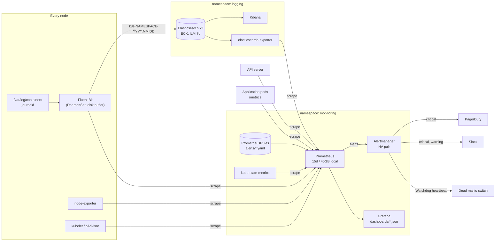

# k8s-observability-stack

[](https://github.com/gopisaluja/k8s-observability-stack/actions/workflows/ci.yml)

Opinionated metrics, logging and alerting for Kubernetes:

- **Metrics and alerting:** Prometheus, Alertmanager and Grafana via kube-prometheus-stack,
  with severity-based routing to PagerDuty and Slack.
- **Logging (EFK):** Fluent Bit ships container and node logs to Elasticsearch, with
  Kibana on top. Elasticsearch and Kibana run on the ECK operator.
- **SLOs:** multi-window, multi-burn-rate alerts for an example HTTP service, following
  the Google SRE Workbook, with promtool unit tests.
- **Operations:** a runbook for every alert group, a postmortem template, and three Grafana
  dashboards as code.

> **Status.** This is a reference implementation. CI checks every part of it (promtool,
> rule unit tests, `helm template` against the pinned charts, yamllint, shellcheck,
> dashboard and alert linting), but this exact repository has not been run against a live
> cluster. Review sizing, retention and receivers for your environment before using it.

## Contents

- [Architecture](#architecture)
- [What you get](#what-you-get)
- [Install](#install)
- [How alert routing works](#how-alert-routing-works)
- [SLO approach](#slo-approach)
- [Testing](#testing)
- [Design decisions and trade-offs](#design-decisions-and-trade-offs)
- [Not included](#not-included)

## Architecture



## What you get

| Component | Chart (pinned in [`scripts/install.sh`](scripts/install.sh)) | Values |
| --- | --- | --- |
| Prometheus Operator, Prometheus, Alertmanager, Grafana, node-exporter, kube-state-metrics | `prometheus-community/kube-prometheus-stack` **92.11.0** | [`kube-prometheus-stack.yaml`](helm-values/kube-prometheus-stack.yaml) |
| ECK operator | `elastic/eck-operator` **3.5.0** | [`eck-operator.yaml`](helm-values/eck-operator.yaml) |
| Elasticsearch 9.5.0 (3 nodes, TLS, least-privilege users, ILM) | `elastic/eck-elasticsearch` **0.20.0** | [`elasticsearch.yaml`](helm-values/elasticsearch.yaml) |
| Kibana 9.5.0 | `elastic/eck-kibana` **0.20.0** | [`kibana.yaml`](helm-values/kibana.yaml) |
| Fluent Bit 5.1.x | `fluent/fluent-bit` **0.58.3** | [`fluent-bit.yaml`](helm-values/fluent-bit.yaml) |
| Elasticsearch metrics | `prometheus-community/prometheus-elasticsearch-exporter` **7.4.0** | [`elasticsearch-exporter.yaml`](helm-values/elasticsearch-exporter.yaml) |

On top of the charts:

| Path | What is in it |
| --- | --- |
| [`alerts/`](alerts/) | 25 alerts in five PrometheusRule files: [node](alerts/node.yaml) (disk, memory, readiness), [workloads](alerts/workloads.yaml) (CrashLoopBackOff, pods not ready, HPA maxed, PVC filling), [control plane](alerts/control-plane.yaml) (API server availability, latency, errors; etcd), [logging](alerts/logging.yaml) (Fluent Bit delivery, Elasticsearch health) and [SLOs](alerts/slo-example-api.yaml) (20 recording rules + 4 burn-rate alerts). Every alert has `severity`, `summary`, `description` and a `runbook_url` into this repo. |
| [`docs/runbooks/`](docs/runbooks/) | One runbook per alert group: symptoms, impact, triage (kubectl and PromQL), mitigation, escalation, post-incident. |
| [`docs/postmortem-template.md`](docs/postmortem-template.md) | Blameless RCA template: impact with error budget spent, timeline, 5 whys, detection review, action items. |
| [`dashboards/`](dashboards/) | Grafana dashboards with a templated data source: cluster overview, SLO / error budget, logging pipeline health. |
| [`tests/`](tests/) | promtool unit tests for the SLO burn-rate alerts and the workload alerts (including CrashLoopBackOff). |
| [`scripts/`](scripts/) | Idempotent installer, local validation, and the small linters CI runs. |

```text
.
├── alerts/                  PrometheusRule manifests (applied with kubectl)
├── dashboards/              Grafana dashboard JSON (loaded by the Grafana sidecar)
├── docs/
│   ├── postmortem-template.md
│   └── runbooks/            node, workloads, control-plane, slo, logging
├── helm-values/             one values file per Helm release
├── scripts/
│   ├── install.sh           helm repo add + upgrade --install, rules, dashboards
│   ├── validate.sh          run the CI checks locally
│   ├── extract-rules.py     PrometheusRule -> plain rule files for promtool
│   ├── lint-alerts.py       severity, annotations and runbook links on every alert
│   └── check-dashboards.py  dashboard JSON, uids, templated data source
├── tests/                   promtool rule unit tests
└── .github/workflows/ci.yml
```

## Install

Requirements: `kubectl` pointing at the target cluster, `helm` 3.8+ (CI uses 3.22.1), `openssl`, and
a default StorageClass that supports `ReadWriteOnce` volumes.

```bash
export CLUSTER_NAME=staging-eu1                      # becomes cluster="..." on every alert
export SLACK_WEBHOOK_URL='https://hooks.slack.com/services/...'
export PAGERDUTY_ROUTING_KEY='...'                   # Events API v2 integration key
export DEADMANSSWITCH_URL='https://...'              # heartbeat URL (healthchecks.io, PagerDuty heartbeat, ...)

scripts/install.sh            # everything: metrics, then logging
```

Or one part at a time:

| Command | Does |
| --- | --- |
| `scripts/install.sh metrics` | kube-prometheus-stack, then `kubectl apply -f alerts/`, then dashboards as ConfigMaps |
| `scripts/install.sh logging` | ECK operator, Elasticsearch, Kibana, Fluent Bit, exporter (needs `metrics` first for the ServiceMonitor CRD) |
| `scripts/install.sh rules` | re-apply `alerts/` only |
| `scripts/install.sh dashboards` | re-apply `dashboards/` only |
| `scripts/install.sh template` | render every release into `.build/rendered/`, no cluster needed |

The script is safe to re-run. Helm releases use `upgrade --install` with pinned versions,
manifests use `kubectl apply`, and generated credentials (Grafana admin, the Fluent Bit and
exporter Elasticsearch users) are only created when their Secret does not exist. Receiver
credentials are written to the `alertmanager-receivers` Secret from files, never on the
command line; without the three variables an existing Secret is kept, or a placeholder one is
created and the script warns.

After the Elasticsearch release, a Helm hook Job waits for the cluster and applies the ILM
policy (`k8s-logs`, delete after 7 days) and the index template for `k8s-*`. In Kibana,
create a data view for `k8s-*`.

**Upgrading a chart:** change its version in `scripts/install.sh`, run
`scripts/install.sh template` before and after and diff `.build/rendered/`, read the chart's
upgrade notes (kube-prometheus-stack does not upgrade its CRDs on `helm upgrade`), then let
CI run before rolling out.

## How alert routing works

Every alert carries a `severity` label, and Alertmanager routes on it:

| Severity | Receiver | Meaning | Repeat |
| --- | --- | --- | --- |
| `critical` | PagerDuty **and** `#alerts-critical` | Users are affected now, or will be within minutes (fast SLO burn, disk about to fill, API server down, Elasticsearch red). Someone gets woken up. | 1h |
| `warning` | `#alerts-warning` | Needs a human today, in working hours (slow SLO burn, crash loop, PVC trending to full). | 12h |
| `info` | nowhere | Context only: visible in Alertmanager and Grafana. | n/a |
| no severity | `#alerts-warning` | Fallback, so a mislabelled alert is still seen. | 4h |
| `Watchdog` | dead man's switch | Always-firing heartbeat. If it stops arriving, the alerting pipeline itself is broken. | 1m |

Other behaviour, all in [`helm-values/kube-prometheus-stack.yaml`](helm-values/kube-prometheus-stack.yaml):

- **Grouping** by `cluster`, `alertname`, `namespace`: a node problem that breaks forty pods
  sends one notification per alert name, not forty.
- **Inhibition:** a `critical` alert mutes the `warning` version of the same alert on the same
  object (PVC 97% full mutes "PVC filling up"); a fast SLO burn mutes the slow burn for the
  same SLO; a nearly full disk mutes its "will fill up" prediction; Elasticsearch RED mutes
  the Fluent Bit delivery alerts it causes.
- **Secrets stay out of Git:** the Slack webhook, PagerDuty routing key and heartbeat URL are
  read from files (`*_file` settings) mounted from the `alertmanager-receivers` Secret.
- **Notifications** include the summary, description and runbook link (Slack text, PagerDuty
  link) via a small template in the same values file.
- **No duplicates:** upstream kube-prometheus-stack alerts that this repo replaces (same
  purpose, with local runbooks and tests) are disabled via `defaultRules.disabled`.

To check a routing change before deploying it:

```bash
yq '.alertmanager.config' helm-values/kube-prometheus-stack.yaml > /tmp/alertmanager.yaml
amtool check-config /tmp/alertmanager.yaml
amtool config routes test --config.file=/tmp/alertmanager.yaml severity=critical alertname=Test
# -> pagerduty-critical,slack-critical
```

## SLO approach

The example service `example-api` has two SLOs over a rolling 30 days:

| SLO | SLI (good events / valid events) | Objective | Error budget |
| --- | --- | --- | --- |
| Availability | requests not answered with 5xx / all requests | 99.9% | 0.1% of requests (~43 min of full outage per 30 days) |
| Latency | requests faster than 300ms / all requests | 99% | 1% of requests |

**Error budget.** The objective is deliberately below 100%: the remaining 0.1% is a budget
the team can spend on releases, experiments and failures. The dashboard shows how much is
left; the [error-budget policy](docs/runbooks/slo.md#error-budget-policy) says what happens
when it runs low.

**Burn rate** is how fast the budget is being spent: error ratio divided by the budget. At a
burn rate of 1 the budget lasts exactly 30 days. At 14.4 it lasts about 2 days.

**Multi-window, multi-burn-rate alerts** (SRE Workbook, chapter 5). Each alert needs a long
window to show a significant share of budget was spent, and a short window (1/12 of the long
one) to show it is still happening, so alerts fire quickly on real problems and resolve
minutes after recovery instead of hours:

| Alert | Long window | Short window | Burn rate | Budget spent | Action |
| --- | --- | --- | --- | --- | --- |
| `SLO*FastBurn` | 1h | 5m | 14.4 | 2% | page |
| `SLO*FastBurn` | 6h | 30m | 6 | 5% | page |
| `SLO*SlowBurn` | 1d | 2h | 3 | 10% | ticket |
| `SLO*SlowBurn` | 3d | 6h | 1 | 10% | ticket |

Budget spent = burn rate x long window / 30 days, e.g. 14.4 x 1h / 720h = 2%.

**Implementation.** Recording rules compute `slo:sli_error:ratio_rate<window>` for each window,
labelled with `service` and `slo`, plus `slo:objective:ratio` and
`slo:error_budget_remaining:ratio30d` for the dashboard. The alerts compare the recorded
ratios with `burn rate x (1 - objective)`. To add a service, copy
[`alerts/slo-example-api.yaml`](alerts/slo-example-api.yaml), change the selector, labels and
objectives, and add a test case. The [unit tests](tests/slo-example-api.test.yaml) check the
thresholds, that a healthy service and a 0.2% error rate do not page, and that the page
resolves once a 10-minute error spike is over even though the 1h window still looks bad.

## Testing

CI ([`.github/workflows/ci.yml`](.github/workflows/ci.yml)) runs on every push and pull
request; actions and images are pinned to release versions (actions by commit SHA).

| Job | Checks |
| --- | --- |
| lint | `yamllint --strict`; dashboard JSON, unique uids and templated data source on every query; every alert has a severity, summary, description and a runbook link whose file and heading exist |
| prometheus-rules | unwraps `spec.groups` from the PrometheusRule manifests, then `promtool check rules` and `promtool test rules` (Prometheus v3.15.0, the version the chart deploys) |
| shellcheck | all scripts |
| helm-template | `scripts/install.sh template`: renders all six releases with the pinned chart versions and these values |

Run the same checks locally (needs Python with PyYAML and yamllint, and Docker):

```bash
scripts/validate.sh
scripts/install.sh template   # needs helm
```

## Design decisions and trade-offs

### EFK vs Loki

This stack uses Elasticsearch because it gives full-text search over unstructured logs,
fast ad-hoc queries in Kibana during incidents, and per-index retention and access control.
The cost is real: Elasticsearch needs memory (heap), fast disks and care with shard counts,
and it indexes every field.

[Loki](https://grafana.com/oss/loki/) indexes only labels and keeps log content compressed in
object storage, so it is much cheaper per GB and simpler to operate, and it lives in the same
Grafana as the metrics. It is the better default when logs are mostly queried by
namespace/app label plus a filter, or when volume is high and budget is tight. Swapping is
contained: Fluent Bit stays, and only its `[OUTPUT]` section changes.

ECK is used instead of a plain StatefulSet chart because it handles TLS, users, rolling
upgrades and safe scale-down; the old standalone `elastic/elasticsearch` chart stopped at 8.5.1.

### Index per namespace per day

`k8s-<namespace>-YYYY.MM.DD` makes retention, per-team access and "who is filling the disk"
easy, and one team's mapping conflicts cannot break another team's logs (JSON fields are
also nested under `app.`). The cost is shard count: 1 primary + 1 replica per namespace per
day. 50 namespaces x 7 days = 700 shards, well within limits for three nodes, but 500
namespaces would not be. At that scale switch to data streams (one stream per team or tier)
with rollover by size.

### Retention vs cost

| Data | Retention | Sizing note |
| --- | --- | --- |
| Metrics | 15 days or 45GB on a 50Gi volume, whichever first | Prometheus memory follows active series (`prometheus_tsdb_head_series`), not retention. A 30s scrape interval halves samples compared with 15s. Long-term history belongs in remote storage (Thanos, Mimir or a managed service), not on this volume. |
| Logs | 7 days (ILM delete) | Disk needed is roughly daily indexed volume x 2 (one replica) x 7 days, plus headroom for the 85% watermark. The default 3 x 100Gi fits about 15-18GB/day of indexed logs. |
| Alertmanager | 120h of silences and notification state | Small; on a 2Gi volume. |

Logs are usually the biggest observability bill, and most of it comes from a few noisy
services. Per-namespace indices make those easy to find; lowering their log level is cheaper
than more disks.

### Burn-rate alerts vs threshold alerts

A threshold alert such as "error rate > 1% for 5 minutes" is easy to write but does not know
how much the errors matter: it pages for a 6-minute blip that costs 0.2% of the monthly budget
and stays silent for a steady 0.5% error rate that will blow the SLO in a week. Burn-rate
alerts tie paging to user impact over time: fast burns page, slow burns become tickets, and
the short windows stop alerts from firing for hours after recovery. The trade-off is that they
need traffic (low-traffic services produce noisy ratios, so consider a minimum request rate),
a few recording rules per SLO, and agreement on objectives with the service owners.

Cause-based alerts (crash loops, disks, nodes) are still here, but almost all of them are
`warning`: they explain an SLO page or prevent the next one, and only a handful that predict
imminent outage page directly.

### Alert fatigue controls

- **Page on symptoms, not causes.** Only SLO fast burns and a short list of imminent-outage
  alerts are `critical`.
- **Every alert is actionable and documented.** CI fails if an alert has no severity, summary,
  description or runbook heading.
- **`for:` durations and smoothing** (e.g. `max_over_time` for crash loops) so flapping
  conditions do not page.
- **Inhibition and grouping** so one cause produces one notification.
- **No duplicate rule sets:** replaced upstream alerts are disabled by name.
- **Repeat intervals** of 1h for critical and 12h for warning, so open alerts do not spam.
- **Dead man's switch** so a silent pager means "all good", not "alerting is broken".
- **Review alerts regularly:** an alert nobody acted on in a month should be fixed or deleted.
  `sum by (alertname) (count_over_time(ALERTS{alertstate="firing"}[30d]))` is a good starting list.

### Smaller decisions

- **Rules are applied with `kubectl`, not inside a Helm release,** so `{{ $labels }}` templates
  need no escaping and rule changes do not require a chart upgrade.
- **Prometheus discovers monitors and rules in all namespaces** (`*SelectorNilUsesHelmValues:
  false`) so teams can ship their own ServiceMonitors and PrometheusRules.
- **Fluent Bit buffers on the node's disk** with 30 retries (about 2.5h at the 5-minute
  back-off cap) and a 4G cap per output: an Elasticsearch outage of a couple of hours loses
  nothing; beyond that the oldest chunks are dropped rather than blocking the node.
- **Least privilege for the pipeline:** Fluent Bit can only create and write `k8s-*` indices;
  the exporter only has `monitor`. The `elastic` superuser is for break-glass use.
- **Managed control plane by default:** scheduler, controller-manager, etcd and kube-proxy
  scraping are off, since they cannot be reached on EKS/GKE/AKS. Turn them on for kubeadm
  or RKE2 clusters.

## Not included

Deliberately out of scope, and the usual next steps: long-term metrics storage
(Thanos/Mimir), tracing (OpenTelemetry, Tempo), Ingress and SSO for Grafana and Kibana,
NetworkPolicies, multi-cluster aggregation, and automated Kibana data views.

## License

[MIT](LICENSE)
